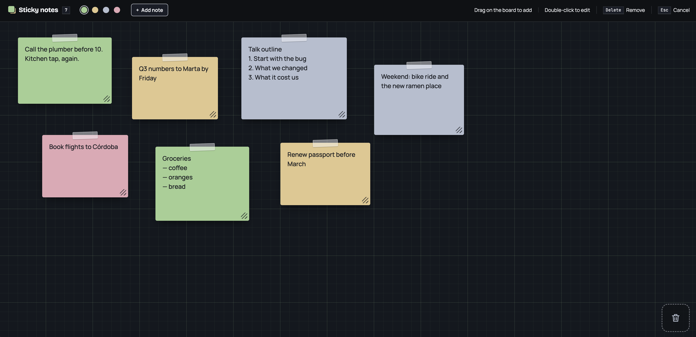
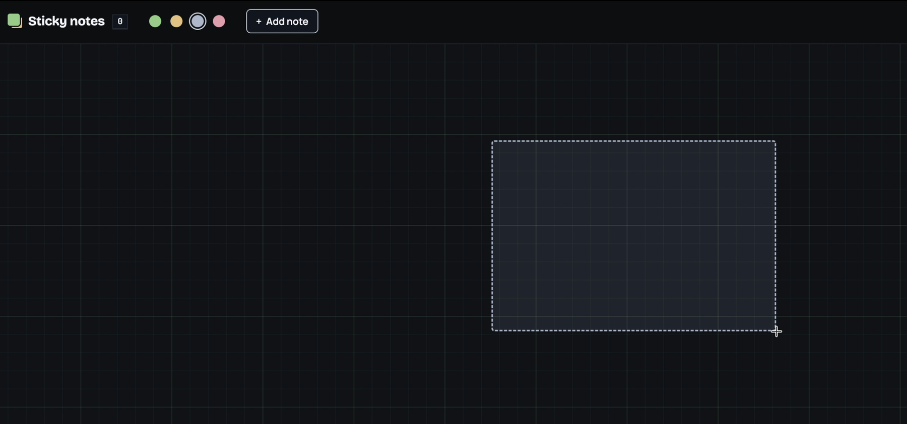
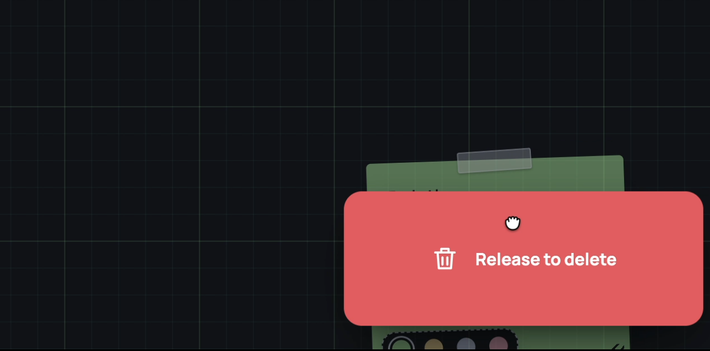
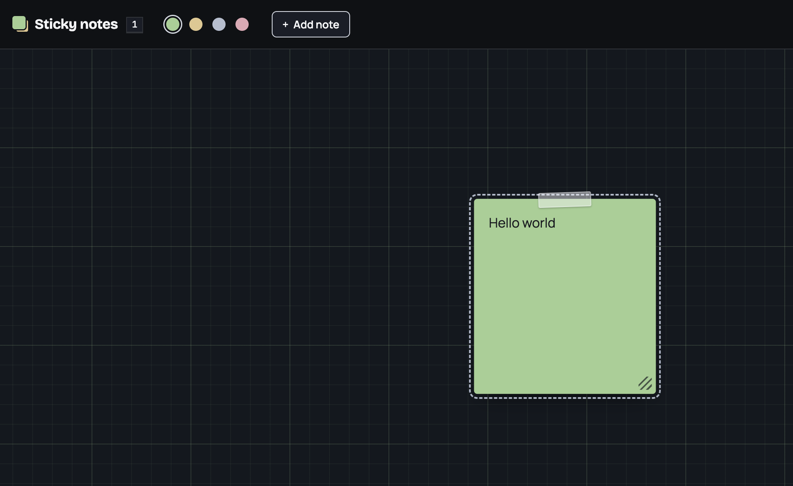
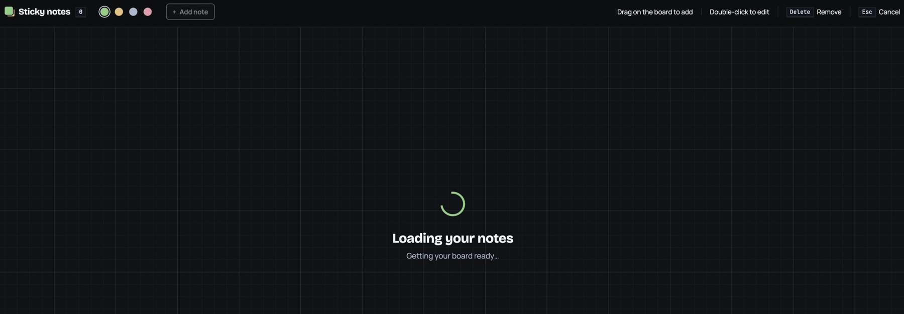
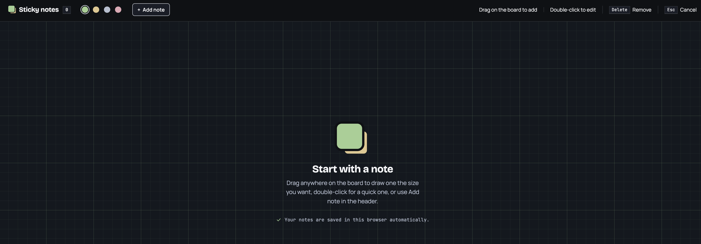

# Sticky Notes

A single-page sticky notes board built with React and TypeScript, without UI libraries.

**Live demo: [albizupatricio.github.io/sticky-notes](https://albizupatricio.github.io/sticky-notes/)**



## Contents

- [Features](#features)
- [Screenshots](#screenshots)
- [Keyboard](#keyboard)
- [Getting started](#getting-started)
- [Tech stack](#tech-stack)
- [Project structure](#project-structure)
- [Testing](#testing)
- [Architecture](#architecture)
- [Decisions](#decisions)
- [Known issues](#known-issues)
- [Possible improvements](#possible-improvements)

## Features

- **Create** a note by dragging on the board to draw it at the size you want, double-clicking for a default one, or with the **Add note** button in the header, which places it in the center.
- **Move** a note by dragging it. It stays inside the board.
- **Resize** a note from its bottom-right corner, down to a minimum size.
- **Delete** a note by dropping it on the trash. The trash grows as a note gets close and turns red when releasing will delete.
- **Edit** text with a double-click. Click outside (or `Cmd/Ctrl + Enter`) to save, `Esc` to discard.
- **Bring to front:** the note you touch moves on top.
- **Colors:** pick the color for new notes in the header, or change a note's color from its swatches.
- **Saved automatically** in the browser (localStorage), loaded through a mock async API.
- **Keyboard support:** everything above can be done without a mouse (see _Keyboard_).
- **Loading and empty states:** a loading state while notes arrive, and a short how-to on an empty board.

## Screenshots

|                                                                                         |                                                                                                                |
| --------------------------------------------------------------------------------------- | -------------------------------------------------------------------------------------------------------------- |
|           |                |
| **Drawing a note** in the color picked in the header                                    | **Deleting:** the trash grows as a note gets close and turns red when releasing will delete                    |
|                           |  |
| **Editing** a note's text                                                               | **Loading:** the board blocks input and Add note is disabled until notes arrive                                |
|  |                                                                                                                |
| **Empty board** with a short how-to                                                     |                                                                                                                |

## Keyboard

Everything can be done without a mouse. Notes and controls follow the normal `Tab` order.

| Keys                                 | Where                     | Action                                                                                                                                                          |
| ------------------------------------ | ------------------------- | --------------------------------------------------------------------------------------------------------------------------------------------------------------- |
| `Tab` / `Shift + Tab`                | Anywhere                  | Moves focus through the header (new note color, **Add note**) and then the notes and their color swatches                                                       |
| `Enter`                              | Add note                  | Creates a note in the center of the board, in the selected color, ready to type. Disabled while notes load                                                      |
| `Enter`                              | Note                      | Edit its text                                                                                                                                                   |
| `Cmd/Ctrl + Enter`                   | Editing                   | Save and return focus to the note                                                                                                                               |
| `Esc`                                | Editing                   | Discard changes and return focus to the note                                                                                                                    |
| Arrow keys                           | Note                      | Move it 4px                                                                                                                                                     |
| `Alt` (`Option` on Mac) + arrow keys | Note                      | Resize it 4px: right/down grow, left/up shrink. The top-left corner stays fixed, as with the mouse handle                                                       |
| `Shift` + any of the above           | Note                      | Use 24px steps (one grid cell)                                                                                                                                  |
| `Delete` or `Backspace`              | Note                      | Delete it. Both are bound because the key labeled "delete" on a Mac sends `Backspace`. It only works when the note itself has focus, not while editing its text |
| `Enter` / `Space`                    | Color swatch              | Change the note's color                                                                                                                                         |
| `Esc`                                | While dragging or drawing | Cancel                                                                                                                                                          |

Moving and resizing with the keyboard follow the same rules as the mouse: notes stay inside the board and never get smaller than the minimum size. Arrow keys work on one axis at a time, as in most editors.

## Getting started

Requires Node.js 22 or later (developed with Node 24).

```bash
npm install
npm run dev        # development server
npm run build      # type-check and production build
npm run lint       # ESLint (npm run lint:fix to fix what it can)
npm run typecheck  # TypeScript, without building
npm run format     # Prettier
npm test           # unit and render tests (Vitest)
```

Every push to `main` runs lint and tests in GitHub Actions and, if they pass, deploys the app to GitHub Pages (`.github/workflows/deploy.yml`).

Built for desktop (minimum 1024×768). Tested manually on the current versions of Chrome, Firefox and Edge on macOS, with no visible differences between them.

## Tech stack

|                      |                                                               |
| -------------------- | ------------------------------------------------------------- |
| UI                   | React 19, TypeScript (strict, `noUncheckedIndexedAccess`)     |
| Styles               | CSS Modules and CSS custom properties, no UI or CSS framework |
| Build                | Vite                                                          |
| Tests                | Vitest, with React's `renderToStaticMarkup` for components    |
| Quality              | ESLint (with import sorting) and Prettier                     |
| Runtime dependencies | `react` and `react-dom` only                                  |

## Project structure

```
src/
├── components/          one folder per component: .tsx, .module.css and .test.tsx side by side
│   ├── Board/           drawing, trash detection, loading and empty states, keyboard focus
│   ├── Note/            move, resize, edit, color and keyboard shortcuts for a single note
│   ├── Trash/           drop target, its states and icon
│   ├── ColorPicker/     swatches used in the header and on each note
│   ├── Header/          title, note count, new note color, hints
│   ├── EmptyState/      how-to shown on an empty board
│   ├── Loading/         shown while notes load
│   └── Logo/            two stacked notes, scalable
├── hooks/
│   └── usePointerDrag.ts   drag logic shared by moving, resizing and drawing
├── lib/                 generic helpers: geometry, combineStyles, assertNever
├── model/               plain TypeScript, no React
│   ├── types.ts            Note, NoteColor and the actions
│   ├── notesReducer.ts     every change to the notes
│   ├── noteSizes.ts        minimum and default sizes
│   ├── notesApi.ts         mock async API (the only module that knows where data comes from)
│   └── notesStorage.ts     localStorage read/write with validation
├── App.tsx              loads, saves, and holds the color for new notes
└── index.css            color tokens and global styles
```

Dependencies go one way: components use `model`, `hooks` and `lib`; `model` and `lib` never import React or components.

## Testing

Tests use Vitest, which shares the Vite config, so TypeScript and ES modules work with no extra setup.

- **Model and helpers:** the reducer (every action, and that raising the top note returns the same state so React skips the render), storage (round trip, corrupt data, invalid entries), the mock API (simulated latency with fake timers, storage mocked), the geometry helpers and `combineStyles`.
- **Components:** every component (`Board`, `Note`, `Header`, `Trash`, `ColorPicker`, `EmptyState`, `Loading`, `Logo`) is rendered with React's `renderToStaticMarkup`, which needs no DOM and no extra dependency. These tests check what each one shows for given props (loading, empty and filled board; a note's text, position, color, placeholder and edit mode; the trash label per state) and the accessibility attributes, not interactions.

The whole suite runs in under a second. Drag, resize and keyboard interactions were tested manually (see _Possible improvements_).

## Architecture

The app is split into three layers. `src/model` is plain TypeScript with no React imports: the note types, a reducer that describes every change as an action (create, move, resize, raise, recolor, edit text, delete, load), the size rules, and the data access (`notesApi.ts` and `notesStorage.ts`). Because the reducer is a pure function, it can be tested without rendering anything. `src/components` only renders the model and dispatches actions: `Board` owns board-level concerns (drawing new notes, the trash, the loading and empty states, keyboard focus), `Note` owns the interactions on a single note (move, resize, edit, color, keyboard shortcuts), and `Header`, `Trash`, `ColorPicker`, `EmptyState`, `Loading` and `Logo` are presentational. The header's **Add note** button reaches the board through a small imperative handle (`BoardHandle`, exposed with `useImperativeHandle`): creating a note needs the board's size and decides which note opens in edit mode, so that logic stays in `Board` and the parent only asks it to `addNote()`. `src/hooks/usePointerDrag.ts` holds the drag logic shared by moving, resizing and drawing, and `src/lib` has small generic helpers (geometry, CSS Module class combining, exhaustiveness check).

Interactions use Pointer Events with pointer capture, so a drag keeps working when the pointer leaves the element. While dragging, the position or size lives in local component state and is applied with CSS `translate`, so only the dragged note re-renders; the reducer receives a single action on release. Notes are rendered in a stable DOM order and stacked with `z-index`, because moving a DOM node would release the pointer capture mid-drag. Notes are memoized, and the callbacks they receive are stable, so the rest of the board doesn't re-render while one note moves.

Data goes through `notesApi.ts`, an async mock with simulated latency that reads localStorage underneath. It is the only module that knows where data comes from: replacing it with `fetch('/api/notes')` wouldn't change any component. Data read from storage is treated as `unknown` and validated before use, the storage key is versioned (`sticky-notes:v1`) so the note shape can evolve, and saving waits until the initial load finishes, so the empty initial state never overwrites saved notes.

## Decisions

- **No UI or drag-and-drop libraries**, as required. Everything is built with React, TypeScript and CSS Modules.
- **Delete by dropping on the trash, without a confirmation dialog.** Dragging a note to the trash is already a deliberate gesture; asking "Are you sure?" adds friction without real safety. Undo would be the better safeguard (see below).
- **Why saving isn't async too.** Loading goes through the mock async API, but saving writes to localStorage directly. An async save done properly needs more than a delay: optimistic updates, handling failures (retry, rollback, or marking notes as "not saved"), keeping requests in order so an older save can't overwrite a newer one, and debouncing so a burst of edits becomes one request. That's a feature on its own, so it was left out of scope. The reducer already updates state first and persists after, so it's ready for that change.
- **No router.** There is a single board, so a router and code splitting would add a dependency without a real benefit (see below).
- **The visual design reuses the palette of my personal site, [patricioalbizu.com](https://www.patricioalbizu.com).** It was an existing, consistent design that fit this kind of tool, so I adapted it instead of starting from scratch. All colors are CSS variables in `src/index.css`.
- **Four note colors**, from that same palette. Adding one is a new entry in `NoteColor` and a `--note-<color>` CSS variable; the pickers are generated from the type.
- **A single dark theme.** A light theme (or following the system's day/night setting) would mean defining and checking a second set of colors for every surface, note and state, so it was left for later. Since every color is already a variable, it would mostly mean adding a second set of values.
- **A visible "Add note" button in the header.** It was first a button that only appeared when reached with `Tab`, for keyboard users. Moving it to the header made it discoverable for everyone, put it first in the tab order, and placed it next to the color it will use. It's styled like the rest of the header (dark surface, thin border) so it doesn't read as another note or another color.
- **Props instead of context between `Board` and `Note`.** A note receives nine props, but they only go one level down and each one is explicit and typed, which also keeps tests simple. If the board's services were needed deeper in the tree, they'd move into a context.
- **Accessibility:** everything can be done with the keyboard, focus is always visible, controls are labeled, color pickers are radio groups, each note links to a hidden description of its shortcuts for screen readers, contrast was checked on text and controls (one exception is listed under _Known issues_), and every animation respects `prefers-reduced-motion`.

## Known issues

- **Dropping a note right on the edge of the trash may not delete it.** Detection uses the pointer position, not the note's area: if the note covers the trash but the pointer is just outside, the note is moved instead. Measuring the overlap between the note and the trash, or extending the hit area slightly beyond the visible edge, would fix it.
- **Quick drags on crowded, overlapping notes can still misbehave.** A note could jump back to where it started after a fast drag released before React re-rendered; tracking "has moved" in a ref instead of in state fixed most cases. It can still happen occasionally when many notes are stacked on top of each other and are grabbed in quick succession. It's intermittent and hard to reproduce.
- **On small notes, the color picker covers part of the text and the resize handle.** It only shows on hover or keyboard focus, but on a note near the minimum size it can overlap the placeholder or the last lines of text. Simply moving it below the note doesn't work: each note has its own `z-index`, so the notes above would cover it. The fix is to render it in a layer of the board, above every note, positioned next to the active note.
- **Notes can end up partly outside the board when the window gets smaller.** Positions are clamped when a note is created, moved or resized, not when the window is resized, so a note placed near the right or bottom edge of a large window is cut off in a smaller one. Moving it brings it back inside. Re-clamping every note on resize (with a `ResizeObserver` on the board) would fix it.
- **The "Release to delete" label has low contrast.** White text on the trash's red (`#e5686b`) is about 2.9:1, below the 4.5:1 WCAG AA asks for normal text. The red was kept because it matches the palette and the label is large and bold; a darker red behind white text (around `#b3343a`, 5.6:1) would fix it.
- **Not tested with screen readers.** The markup follows ARIA practices (labels, roles, descriptions, a status message while loading), but it hasn't been checked with VoiceOver, NVDA or JAWS, so the actual announcements may need adjusting.
- **Tab order between notes doesn't follow their position on screen.** It follows the DOM order, which is kept stable on purpose so a drag never loses pointer capture.

## Possible improvements

- **Test with screen readers** (VoiceOver on macOS, NVDA on Windows) and adjust the announcements.
- **Split `Note.tsx`** (~300 lines, five responsibilities): move text editing into a `NoteText` component and keyboard handling into a `useNoteKeyboard` hook, leaving `Note` focused on position, dragging and the trash. Likewise, drawing could move from `Board` into a `useDrawNote` hook. Left for after the submission because interactions aren't covered by automated tests yet.
- **Shorter accessible names for long notes:** the note's `aria-label` includes its full text; the first few words would be enough.
- **Keep the render order instead of re-sorting** on every change. Sorting by id is fine for dozens of notes, not for thousands.
- **Undo after deleting:** a short "Note deleted · Undo" message instead of a confirmation.
- **A visible delete button** on each note, as a simpler alternative to dragging.
- **Async saving through the API**, with a "saving…" indicator and error handling, as described above.
- **Network errors on load:** a message with a "Retry" button.
- **Screen reader announcements** for changes (for example, "Note deleted") with an `aria-live` region.
- **Routing and code splitting:** with more screens (several boards, settings), each board would get its own route (`/boards/:id`) and be lazy-loaded with `React.lazy`.
- **Animated delete into the trash:** the note travels to the trash icon instead of fading out in place.
- **A slight, stable tilt per note**, derived from its id, for a more realistic board. Free rotation by the user was ruled out: it complicates resizing, board bounds and trash detection.
- **Light theme**, switched by the user or following the system's `prefers-color-scheme`.
- **Touch and mobile support.** Interactions already use Pointer Events, so this would mostly mean adjusting layout and gestures, not rewriting the drag logic.
- **Interaction tests for components** with Testing Library and jsdom: clicks (color changes), keyboard shortcuts on notes, edit mode. They would also replace the string checks of `renderToStaticMarkup` with queries by role, which are less fragile.
- **Tests for `usePointerDrag`** (pointer capture, cancel with `Esc`, lost capture), which need a simulated DOM and pointer events.
- **End-to-end tests in real browsers** with Playwright: drawing, dragging, resizing and deleting on the trash, run on Chromium, Firefox and WebKit. This is the most reliable way to test drag interactions and would automate the manual cross-browser checks.
